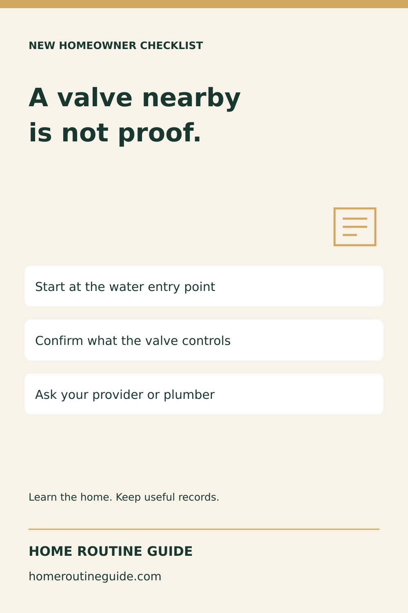
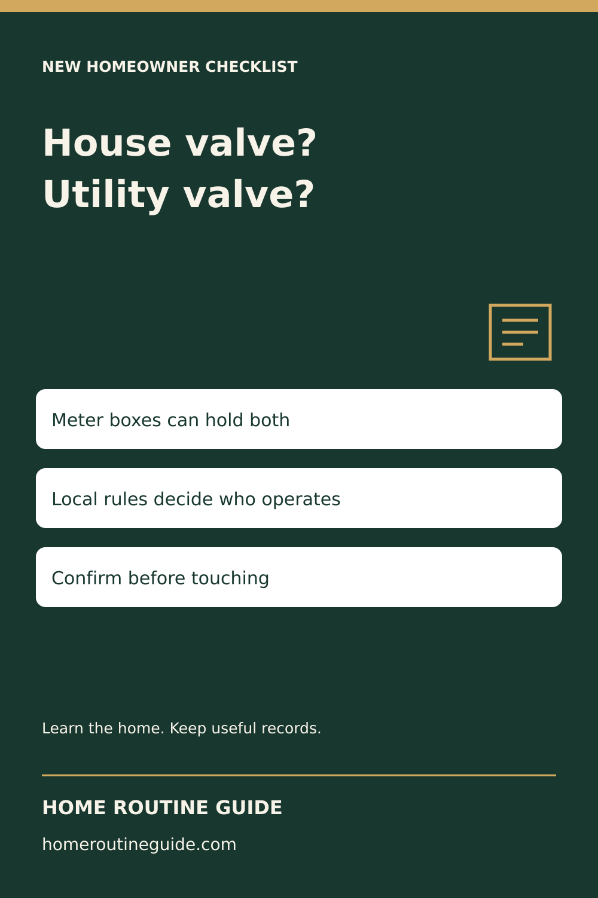
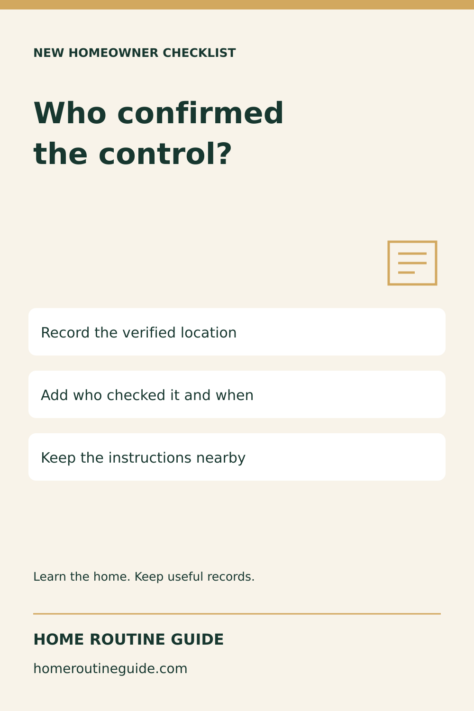
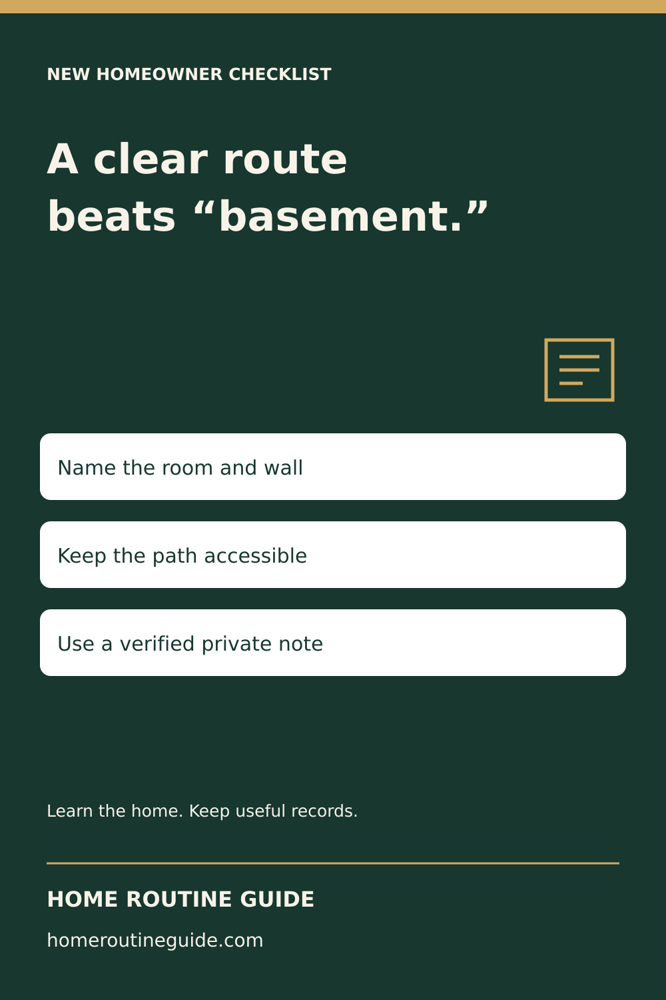
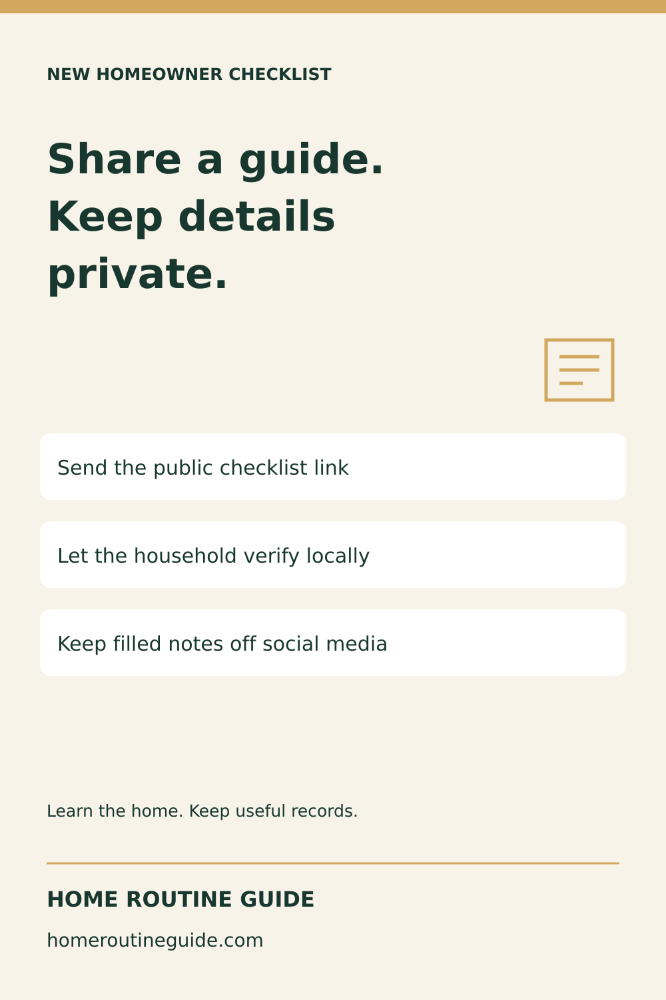

# Water-shutoff campaign — October 12, 2026

Prepared, not posted or scheduled. Five original native-vector graphics, 1000 × 1500. No generated photos, mechanical operating diagrams or customer records.

## Where Is Your Main Water Shutoff? Verify Before Turning

Description: Locate your home’s main water shutoff before an emergency. Nearby valves can serve individual fixtures or utility equipment. Use the free guide to find the right starting point and confirm the control; do not force unfamiliar valves.

Target: https://homeroutineguide.com/where-is-main-water-shutoff.html

Alt: Home Routine Guide: A valve nearby is not proof. Start at the water entry point; Confirm what the valve controls; Ask your provider or plumber.

Image brief: 1000 by 1500 pixels. Forest #17372f, cream #f8f3e9 and gold #d2a85f. Large left-aligned headline: A valve nearby is not proof. Three separate white instruction cards: Start at the water entry point / Confirm what the valve controls / Ask your provider or plumber. Small document outline, generous margins, Home Routine Guide and homeroutineguide.com footer. No valve-operation diagram, personal household data or implied endorsement.

## House Shutoff or Utility Valve? Know the Difference

Description: A meter-box valve is not automatically yours to operate. The free guide explains house, fixture and utility controls with primary utility sources and clear local limits. Ask your own water provider which control is permitted.

Target: https://homeroutineguide.com/where-is-main-water-shutoff.html#which-valve

Alt: Home Routine Guide: House valve? Utility valve? Meter boxes can hold both; Local rules decide who operates; Confirm before touching.

Image brief: 1000 by 1500 pixels. Forest #17372f, cream #f8f3e9 and gold #d2a85f. Large left-aligned headline: House valve? Utility valve? Three separate white instruction cards: Meter boxes can hold both / Local rules decide who operates / Confirm before touching. Small document outline, generous margins, Home Routine Guide and homeroutineguide.com footer. No valve-operation diagram, personal household data or implied endorsement.

## The Missing Detail in Your Water Shutoff Record

Description: A useful shutoff record includes more than a room name. Use the free handoff prompts for the verified location, what it controls, who confirmed it, instruction reference and appropriate contacts. Keep completed records private.

Target: https://homeroutineguide.com/where-is-main-water-shutoff.html#handoff

Alt: Home Routine Guide: Who confirmed the control? Record the verified location; Add who checked it and when; Keep the instructions nearby.

Image brief: 1000 by 1500 pixels. Forest #17372f, cream #f8f3e9 and gold #d2a85f. Large left-aligned headline: Who confirmed the control? Three separate white instruction cards: Record the verified location / Add who checked it and when / Keep the instructions nearby. Small document outline, generous margins, Home Routine Guide and homeroutineguide.com footer. No valve-operation diagram, personal household data or implied endorsement.

## Can Another Household Member Find the Water Shutoff?

Description: After the correct water control is verified, write a clear route and keep access unobstructed. The free guide helps you organize a private household note without buying software or sharing your home’s details publicly.

Target: https://homeroutineguide.com/where-is-main-water-shutoff.html#record

Alt: Home Routine Guide: A clear route beats “basement.” Name the room and wall; Keep the path accessible; Use a verified private note.

Image brief: 1000 by 1500 pixels. Forest #17372f, cream #f8f3e9 and gold #d2a85f. Large left-aligned headline: A clear route beats “basement.” Three separate white instruction cards: Name the room and wall / Keep the path accessible / Use a verified private note. Small document outline, generous margins, Home Routine Guide and homeroutineguide.com footer. No valve-operation diagram, personal household data or implied endorsement.

## A Useful Water Shutoff Checklist for a Homeowner Welcome Note

Description: Add a free water-shutoff handoff checklist to a new-homeowner resource list. Share the public guide, not a filled record or security details. No partnership or permission to redistribute the paid Binder is implied.

Target: https://homeroutineguide.com/where-is-main-water-shutoff.html#handoff

Alt: Home Routine Guide: Share a guide. Keep details private. Send the public checklist link; Let the household verify locally; Keep filled notes off social media.

Image brief: 1000 by 1500 pixels. Forest #17372f, cream #f8f3e9 and gold #d2a85f. Large left-aligned headline: Share a guide. Keep details private. Three separate white instruction cards: Send the public checklist link / Let the household verify locally / Keep filled notes off social media. Small document outline, generous margins, Home Routine Guide and homeroutineguide.com footer. No valve-operation diagram, personal household data or implied endorsement.
