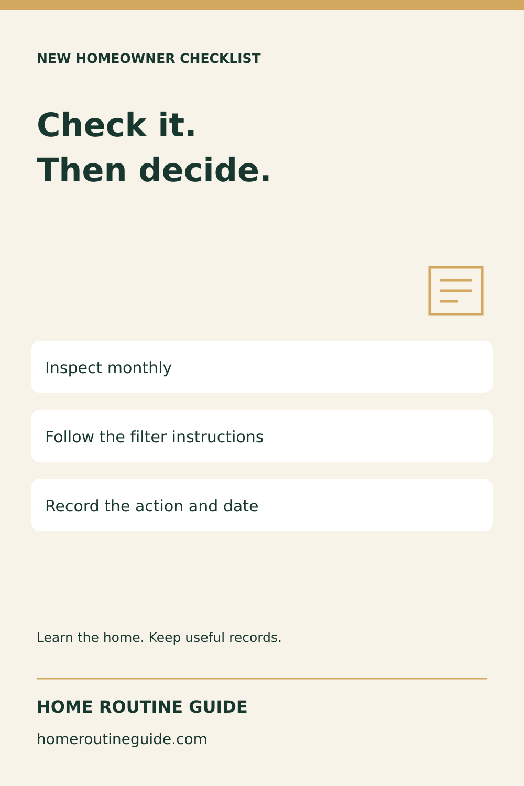
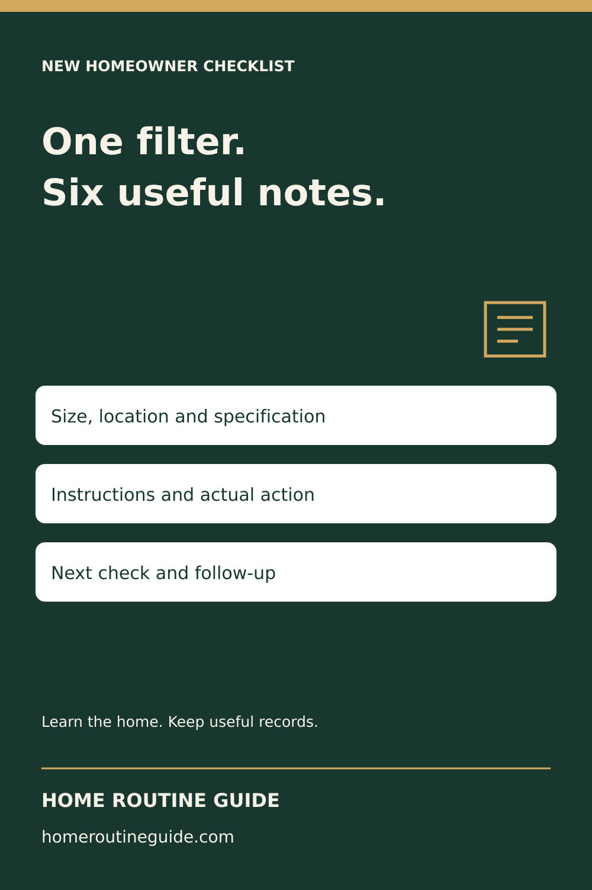
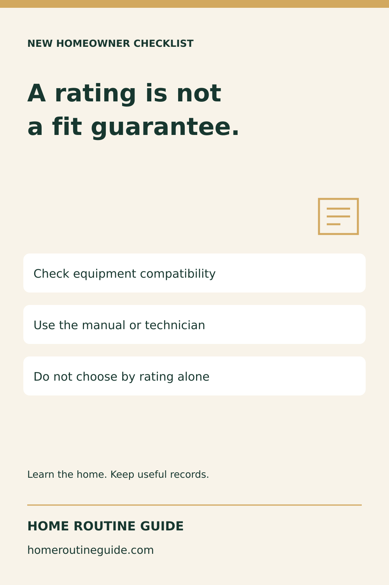
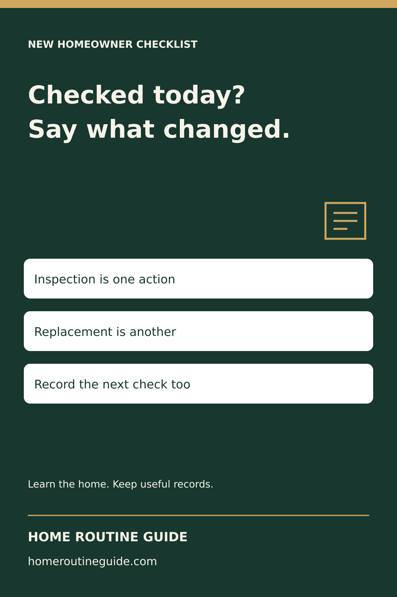
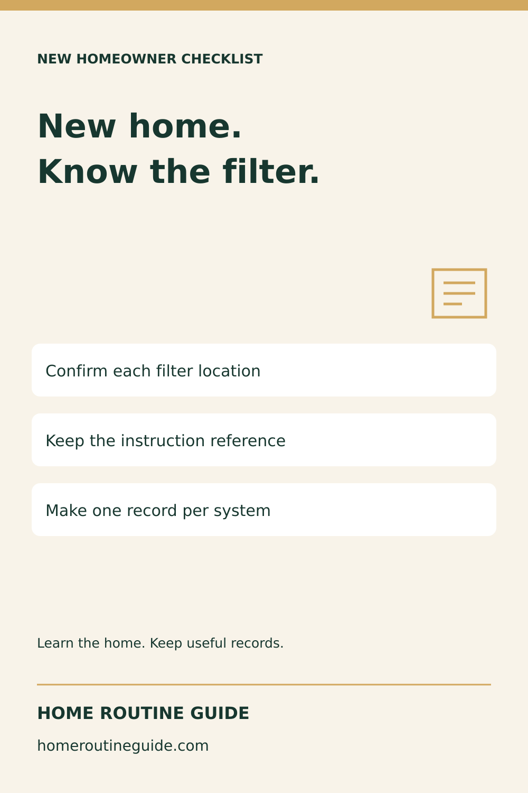

# Filter-record campaign — October 19, 2026

Five original 1000 × 1500 graphics. Prepared, not published or scheduled. Native vector typography; no AI-generated photos or product mockups.

## Check Monthly Does Not Mean Replace Every Month

Description: Start a repeatable HVAC filter routine. Check monthly, especially during heavy use, and follow the equipment and filter instructions for cleaning or replacement. Use the free six-point record to keep the details together.

Target: https://homeroutineguide.com/how-often-change-hvac-filter.html

Alt: Home Routine Guide: Check it. Then decide. Inspect monthly; Follow the filter instructions; Record the action and date.

Image brief: 1000 by 1500 pixels. Forest green #17372f, cream #f8f3e9, gold #d2a85f. Large headline: Check it. Then decide. Three white cards: Inspect monthly / Follow the filter instructions / Record the action and date. Small record icon, generous margins, Home Routine Guide and homeroutineguide.com footer. No equipment-operation diagram, health claim or personal details.

## Six Details to Keep in Your HVAC Filter Record

Description: Copy the free six-point filter record into a private note: system, correct filter, compatible rating, instructions, actual action and next check. No signup or purchase is required.

Target: https://homeroutineguide.com/how-often-change-hvac-filter.html#filter-record

Alt: Home Routine Guide: One filter. Six useful notes. Size, location and specification; Instructions and actual action; Next check and follow-up.

Image brief: 1000 by 1500 pixels. Forest green #17372f, cream #f8f3e9, gold #d2a85f. Large headline: One filter. Six useful notes. Three white cards: Size, location and specification / Instructions and actual action / Next check and follow-up. Small record icon, generous margins, Home Routine Guide and homeroutineguide.com footer. No equipment-operation diagram, health claim or personal details.

## A Higher MERV Rating Is Not a Fit Guarantee

Description: Before changing filter efficiency, confirm what your HVAC system can accommodate. The guide links EPA guidance and explains what to document without guessing from the old filter.

Target: https://homeroutineguide.com/how-often-change-hvac-filter.html#size

Alt: Home Routine Guide: A rating is not a fit guarantee. Check equipment compatibility; Use the manual or technician; Do not choose by rating alone.

Image brief: 1000 by 1500 pixels. Forest green #17372f, cream #f8f3e9, gold #d2a85f. Large headline: A rating is not a fit guarantee. Three white cards: Check equipment compatibility / Use the manual or technician / Do not choose by rating alone. Small record icon, generous margins, Home Routine Guide and homeroutineguide.com footer. No equipment-operation diagram, health claim or personal details.

## Last Checked or Last Replaced? Keep Both Filter Dates

Description: A date alone does not tell the next person whether the filter was inspected, cleaned as instructed, or replaced. Keep the action with the date using the free filter-record prompts.

Target: https://homeroutineguide.com/how-often-change-hvac-filter.html#filter-record

Alt: Home Routine Guide: Checked today? Say what changed. Inspection is one action; Replacement is another; Record the next check too.

Image brief: 1000 by 1500 pixels. Forest green #17372f, cream #f8f3e9, gold #d2a85f. Large headline: Checked today? Say what changed. Three white cards: Inspection is one action / Replacement is another / Record the next check too. Small record icon, generous margins, Home Routine Guide and homeroutineguide.com footer. No equipment-operation diagram, health claim or personal details.

## A Useful HVAC Filter Note for a New Homeowner

Description: Share a useful free filter-record link in a homeowner welcome note or resource list. Let the household confirm its own equipment details and keep completed records private.

Target: https://homeroutineguide.com/how-often-change-hvac-filter.html#filter-record

Alt: Home Routine Guide: New home. Know the filter. Confirm each filter location; Keep the instruction reference; Make one record per system.

Image brief: 1000 by 1500 pixels. Forest green #17372f, cream #f8f3e9, gold #d2a85f. Large headline: New home. Know the filter. Three white cards: Confirm each filter location / Keep the instruction reference / Make one record per system. Small record icon, generous margins, Home Routine Guide and homeroutineguide.com footer. No equipment-operation diagram, health claim or personal details.
