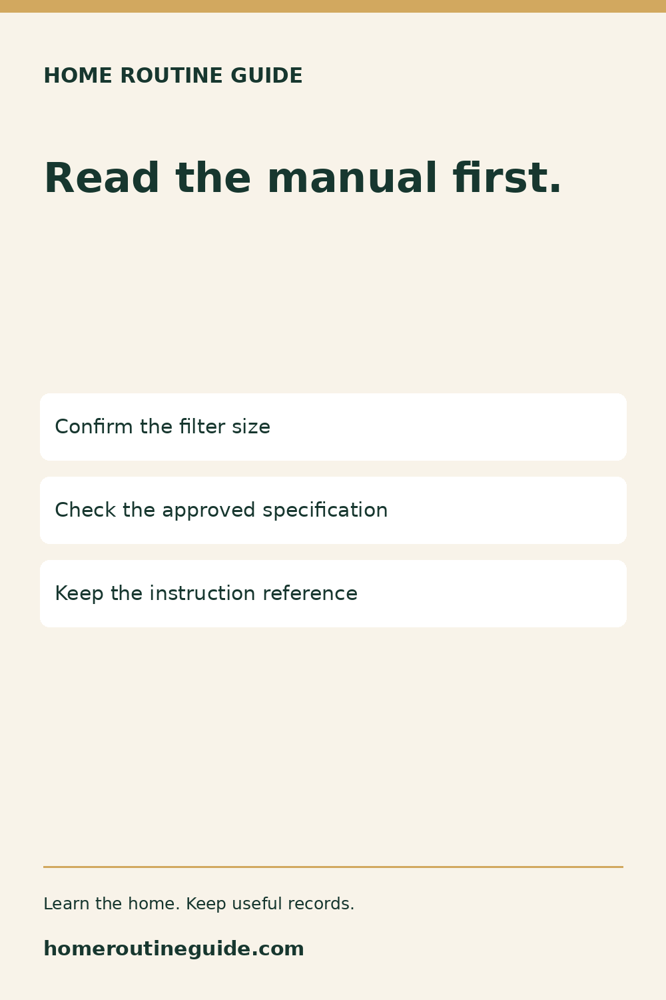
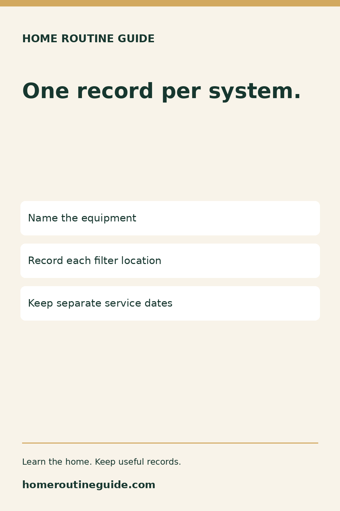
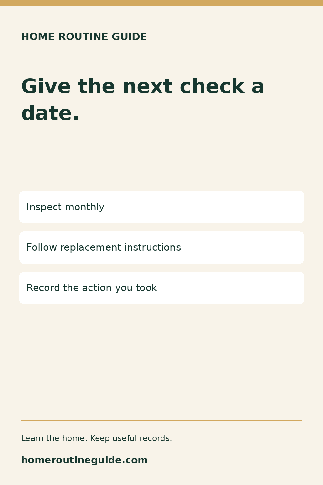
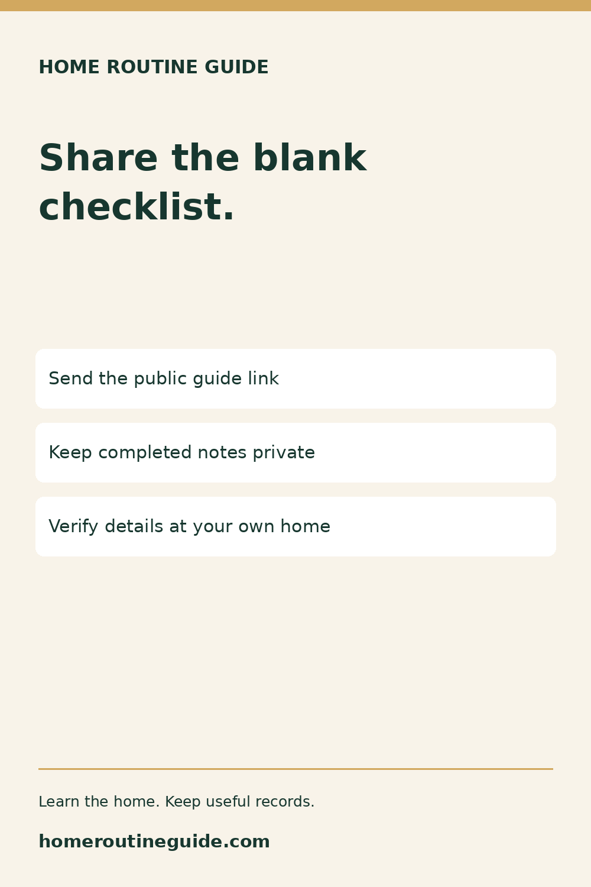
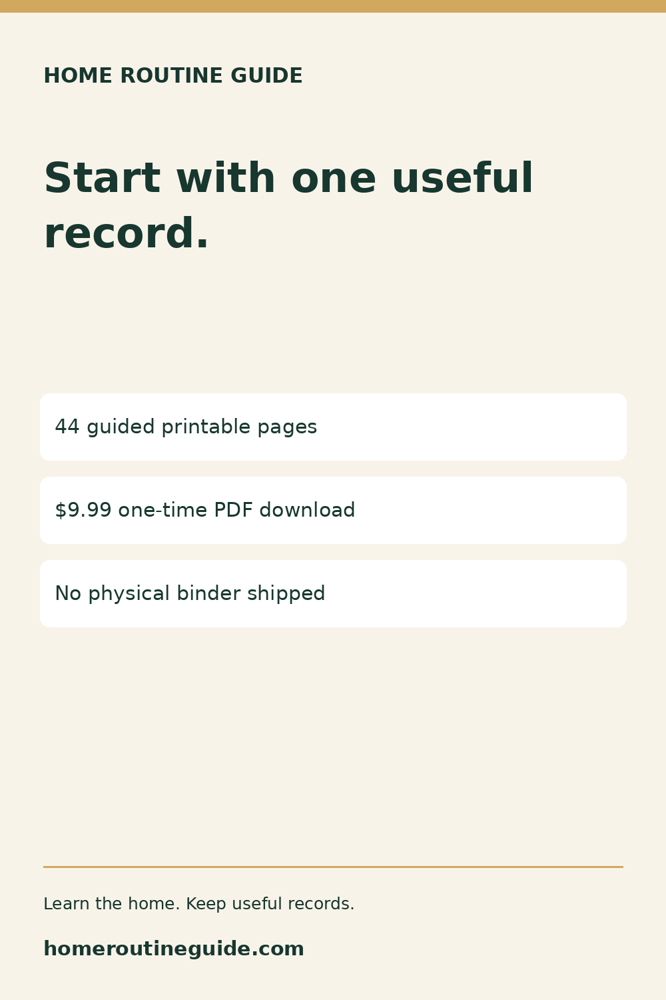

# October 26 campaign

Prepared assets; publication status must be checked in Metricool. Native typography, no AI-generated imagery or mockups.

## Before You Buy Another HVAC Filter

Description: Use the free filter record to confirm your equipment requirements before buying a replacement. Ask a qualified technician when uncertain.

Target: https://homeroutineguide.com/how-often-change-hvac-filter.html#filter-record

Alt: Home Routine Guide: Read the manual first. Confirm the filter size; Check the approved specification; Keep the instruction reference.

Brief: 1000 × 1500; cream background #f8f3e9, forest-green #17372f typography, gold #d2a85f rule; large headline Read the manual first. Three white cards: Confirm the filter size / Check the approved specification / Keep the instruction reference. Brand and website footer; no personal details or equipment-operation diagram.

## Two HVAC Systems? Keep Separate Filter Records

Description: Different systems can use different filters. Keep the confirmed specification and service dates together in a private note.

Target: https://homeroutineguide.com/how-often-change-hvac-filter.html#filter-record

Alt: Home Routine Guide: One record per system. Name the equipment; Record each filter location; Keep separate service dates.

Brief: 1000 × 1500; cream background #f8f3e9, forest-green #17372f typography, gold #d2a85f rule; large headline One record per system. Three white cards: Name the equipment / Record each filter location / Keep separate service dates. Brand and website footer; no personal details or equipment-operation diagram.

## Put Your Next Filter Check on the Calendar

Description: Use the free maintenance calendar to plan a filter check. Inspection and replacement are different actions; follow equipment instructions.

Target: https://homeroutineguide.com/home-maintenance-calendar-printable.html#calendar-worksheet

Alt: Home Routine Guide: Give the next check a date. Inspect monthly; Follow replacement instructions; Record the action you took.

Brief: 1000 × 1500; cream background #f8f3e9, forest-green #17372f typography, gold #d2a85f rule; large headline Give the next check a date. Three white cards: Inspect monthly / Follow replacement instructions / Record the action you took. Brand and website footer; no personal details or equipment-operation diagram.

## Share the Checklist, Keep Home Records Private

Description: A useful free resource for a homeowner welcome note: share the public filter-record prompts, not household details.

Target: https://homeroutineguide.com/how-often-change-hvac-filter.html#filter-record

Alt: Home Routine Guide: Share the blank checklist. Send the public guide link; Keep completed notes private; Verify details at your own home.

Brief: 1000 × 1500; cream background #f8f3e9, forest-green #17372f typography, gold #d2a85f rule; large headline Share the blank checklist. Three white cards: Send the public guide link / Keep completed notes private / Verify details at your own home. Brand and website footer; no personal details or equipment-operation diagram.

## Start Your Home Binder With One Useful Record

Description: Preview the New Homeowner Starter Binder for home systems, warranties, repairs, contractors and planning. Digital download for your own household.

Target: https://homeroutineguide.com/packages.html#preview

Alt: Home Routine Guide: Start with one useful record. 44 guided printable pages; $9.99 one-time PDF download; No physical binder shipped.

Brief: 1000 × 1500; cream background #f8f3e9, forest-green #17372f typography, gold #d2a85f rule; large headline Start with one useful record. Three white cards: 44 guided printable pages / $9.99 one-time PDF download / No physical binder shipped. Brand and website footer; no personal details or equipment-operation diagram.

