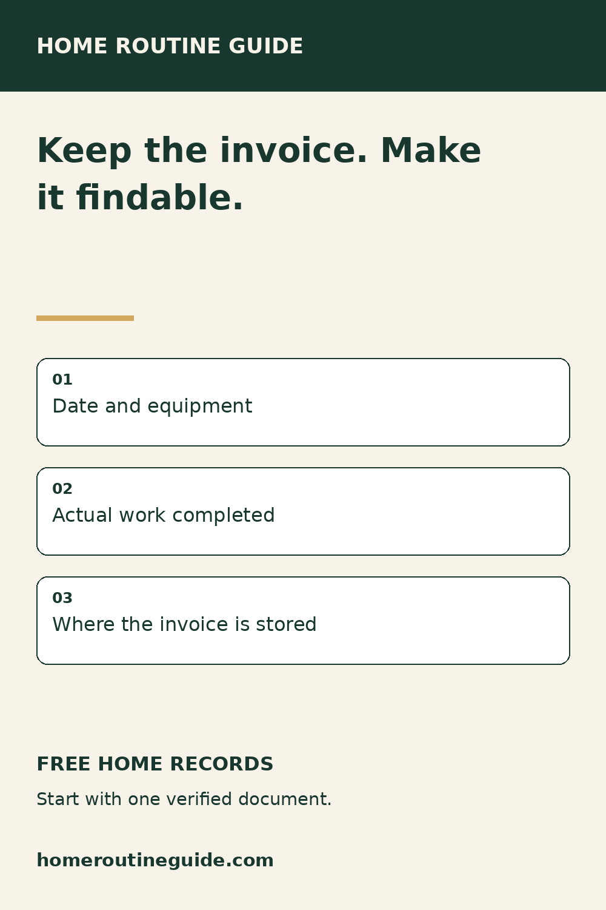
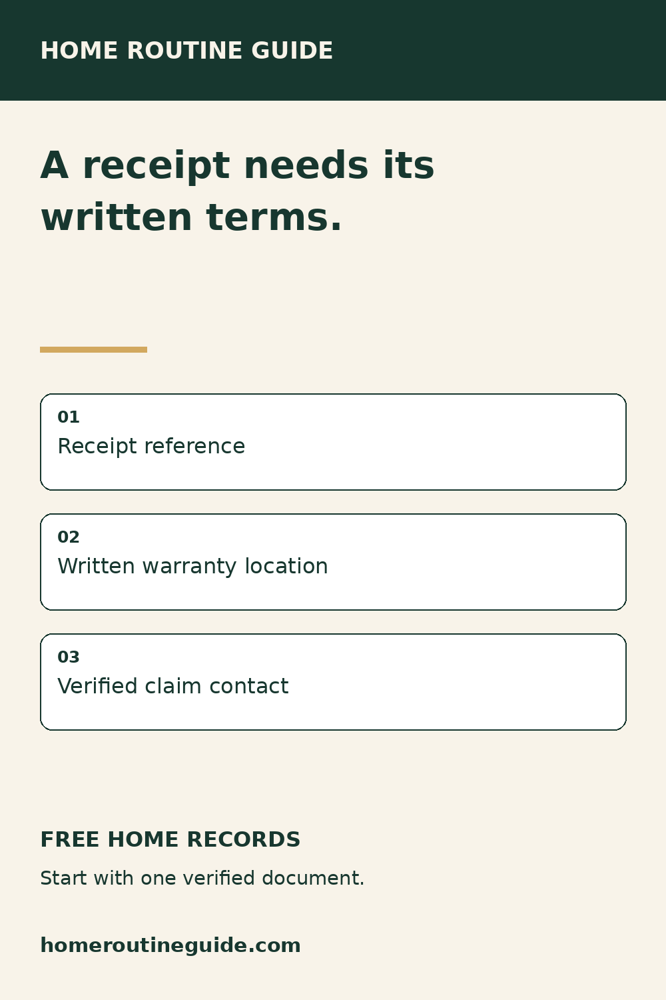
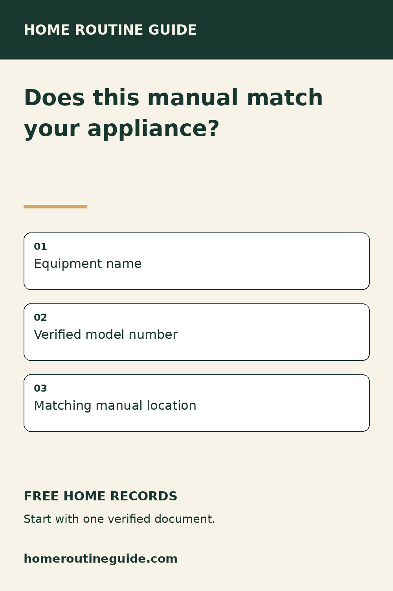
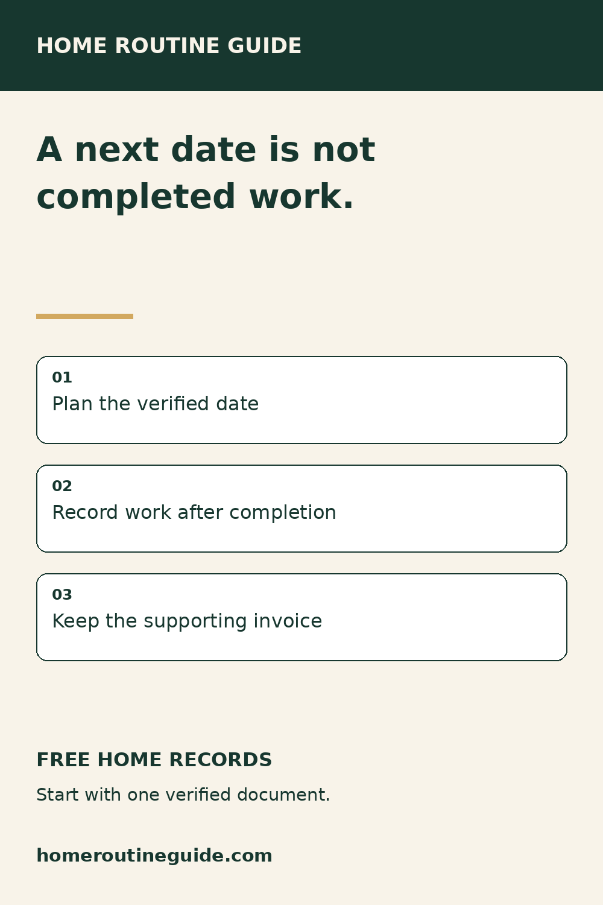
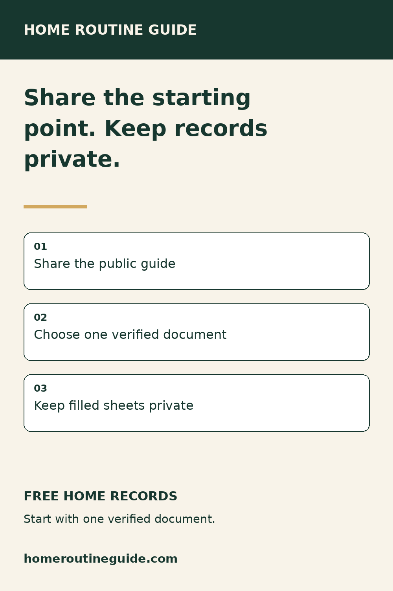

# Home records: one document at a time — November 9, 2026

Prepared only, not posted. Five original 1000-by-1500 PNGs. Native typographic artwork; no AI imagery. Check account, destination and schedule before publication.

## How to Connect a Home Repair Invoice to Your Maintenance Log

Description: Keep the original invoice securely, then use a free log to record the work and where its evidence is stored. No signup is required to print the blank log.

Target: https://homeroutineguide.com/home-maintenance-log-printable.html#blank-log

Alt: Home Routine Guide: Keep the invoice. Make it findable. Date and equipment. Actual work completed. Where the invoice is stored.

Image brief: 1000-by-1500 portrait; cream background, forest-green brand header and type, gold divider; headline “Keep the invoice. Make it findable.”; three numbered white cards: Date and equipment; Actual work completed; Where the invoice is stored. Footer “FREE HOME RECORDS” and homeroutineguide.com. Native typography, no people, mockups or testimonials.

## Keep Appliance Receipts and Warranties Together

Description: Use a free warranty sheet to connect a receipt, written terms and claim instructions. The worksheet organizes records; it does not establish coverage.

Target: https://homeroutineguide.com/home-warranty-tracker-printable.html#warranty-worksheet

Alt: Home Routine Guide: A receipt needs its written terms. Receipt reference. Written warranty location. Verified claim contact.

Image brief: 1000-by-1500 portrait; cream background, forest-green brand header and type, gold divider; headline “A receipt needs its written terms.”; three numbered white cards: Receipt reference; Written warranty location; Verified claim contact. Footer “FREE HOME RECORDS” and homeroutineguide.com. Native typography, no people, mockups or testimonials.

## Start Your Appliance Record With a Verified Model Number

Description: Record verified equipment details and the matching manual location on the free appliance inventory. Leave unknown details blank and keep completed records private.

Target: https://homeroutineguide.com/home-appliance-inventory-printable.html#worksheet

Alt: Home Routine Guide: Does this manual match your appliance? Equipment name. Verified model number. Matching manual location.

Image brief: 1000-by-1500 portrait; cream background, forest-green brand header and type, gold divider; headline “Does this manual match your appliance?”; three numbered white cards: Equipment name; Verified model number; Matching manual location. Footer “FREE HOME RECORDS” and homeroutineguide.com. Native typography, no people, mockups or testimonials.

## Separate Future Maintenance Dates From Completed Work

Description: Use the calendar for verified future tasks and the log for completed work. Choose dates from your equipment instructions or provider, not a generic interval.

Target: https://homeroutineguide.com/home-maintenance-calendar-printable.html#calendar-worksheet

Alt: Home Routine Guide: A next date is not completed work. Plan the verified date. Record work after completion. Keep the supporting invoice.

Image brief: 1000-by-1500 portrait; cream background, forest-green brand header and type, gold divider; headline “A next date is not completed work.”; three numbered white cards: Plan the verified date; Record work after completion; Keep the supporting invoice. Footer “FREE HOME RECORDS” and homeroutineguide.com. Native typography, no people, mockups or testimonials.

## A Free Home Records Starting Point to Share After Closing

Description: Share the public Home Routine Guide records checklist with a new homeowner. They can choose a free sheet for an invoice, manual, warranty or future service date.

Target: https://homeroutineguide.com/home-maintenance-records-to-keep.html#choose-record

Alt: Home Routine Guide: Share the starting point. Keep records private. Share the public guide. Choose one verified document. Keep filled sheets private.

Image brief: 1000-by-1500 portrait; cream background, forest-green brand header and type, gold divider; headline “Share the starting point. Keep records private.”; three numbered white cards: Share the public guide; Choose one verified document; Keep filled sheets private. Footer “FREE HOME RECORDS” and homeroutineguide.com. Native typography, no people, mockups or testimonials.

## Non-Pinterest resource-sharing copy

Home Routine Guide has a free home-records checklist that connects invoices, equipment details, warranties and future service dates to printable worksheets. Choose one document you can verify: https://homeroutineguide.com/home-maintenance-records-to-keep.html#choose-record

Prepared for a public resource list or welcome note. No outreach or listing submissions made. Share public links only; paid Binder redistribution is not permitted by this copy.

Source: https://consumer.ftc.gov/articles/warranties — receipt and written warranty recordkeeping, reviewed November 9, 2026.
