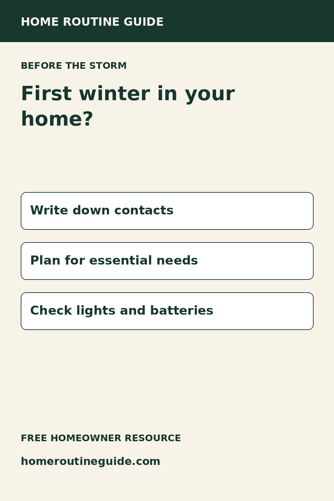
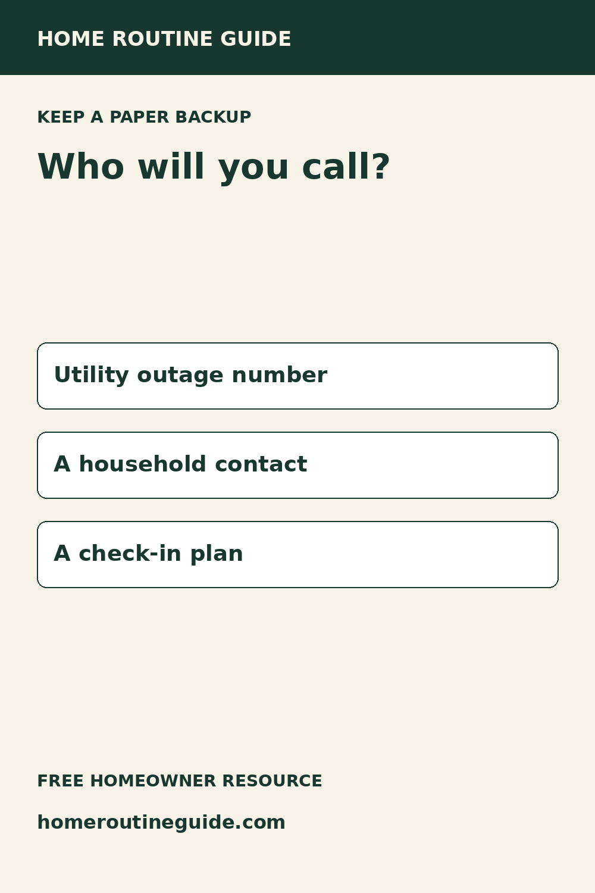
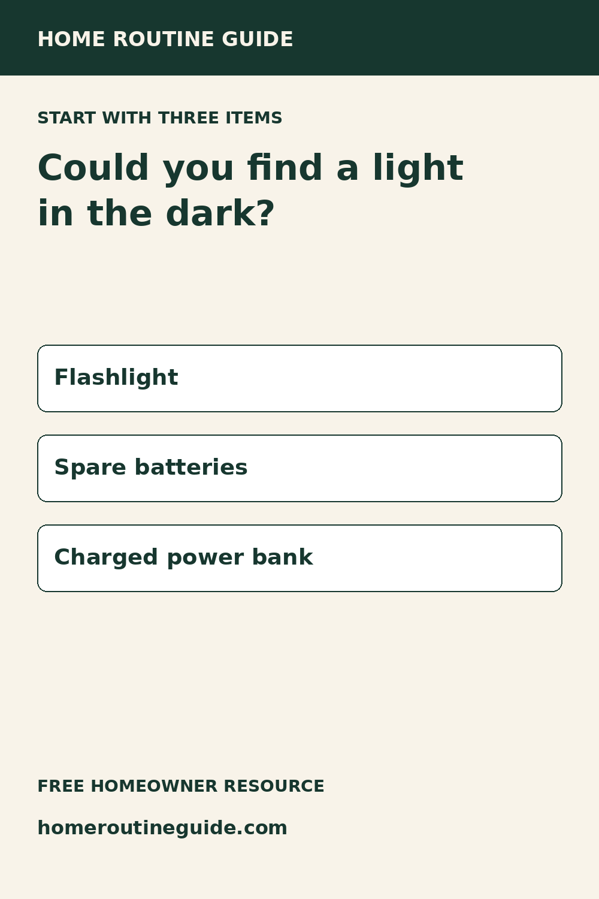
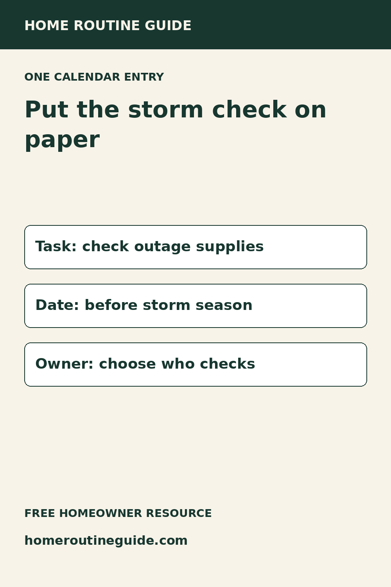
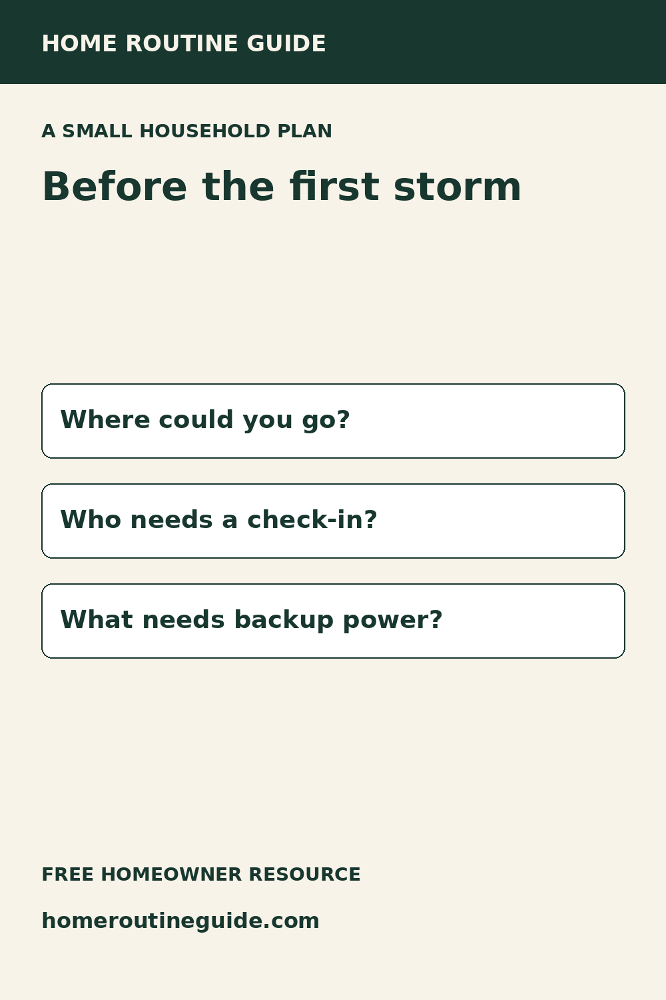

# Winter preparation graphics — November 23, 2026

Prepared, not posted. Original typography and shapes; no people or household details.

## First winter in your home?

Description: Make a simple outage plan before your first winter storm at home.

Target: https://homeroutineguide.com/seasonal-maintenance.html#winter-storm-prep

Alt text: First winter in your home? Write down contacts. Plan for essential needs. Check lights and batteries.

Image brief: 1000×1500 portrait; forest-green brand bar, cream canvas, headline “First winter in your home?”, then three outlined cards: Write down contacts, Plan for essential needs, Check lights and batteries. Footer: Free homeowner resource and site address.

## Who will you call?

Description: Write down the utility outage number, a household contact and who will check in.

Target: https://homeroutineguide.com/seasonal-maintenance.html#winter-storm-prep

Alt text: Who will you call? Utility outage number. A household contact. A check-in plan.

Image brief: 1000×1500 portrait; forest-green brand bar, cream canvas, headline “Who will you call?”, then three outlined cards: Utility outage number, A household contact, A check-in plan. Footer: Free homeowner resource and site address.

## Could you find a light in the dark?

Description: Start with basic lighting and charging supplies, then tailor a free home emergency checklist to your needs.

Target: https://homeroutineguide.com/home-emergency-kit-checklist.html

Alt text: Could you find a light in the dark? Flashlight. Spare batteries. Charged power bank.

Image brief: 1000×1500 portrait; forest-green brand bar, cream canvas, headline “Could you find a light in the dark?”, then three outlined cards: Flashlight, Spare batteries, Charged power bank. Footer: Free homeowner resource and site address.

## Put the storm check on paper

Description: Print a free maintenance calendar and add a reminder to check your outage supplies.

Target: https://homeroutineguide.com/home-maintenance-calendar-printable.html#calendar-worksheet

Alt text: Put the storm check on paper Task: check outage supplies. Date: before storm season. Owner: choose who checks.

Image brief: 1000×1500 portrait; forest-green brand bar, cream canvas, headline “Put the storm check on paper”, then three outlined cards: Task: check outage supplies, Date: before storm season, Owner: choose who checks. Footer: Free homeowner resource and site address.

## Before the first storm

Description: Use a free planning checklist to decide where to go, who needs help and which essentials need backup.

Target: https://homeroutineguide.com/seasonal-maintenance.html#winter-storm-prep

Alt text: Before the first storm Where could you go?. Who needs a check-in?. What needs backup power?.

Image brief: 1000×1500 portrait; forest-green brand bar, cream canvas, headline “Before the first storm”, then three outlined cards: Where could you go?, Who needs a check-in?, What needs backup power?. Footer: Free homeowner resource and site address.

## Shareable resource copy

New to your home? Before winter weather, write down who to call, plan for essential needs, and check where you keep lights and batteries. Use Home Routine Guide’s free winter storm checklist: https://homeroutineguide.com/seasonal-maintenance.html#winter-storm-prep

Share the public link only. No outreach or listing submissions. Source: FEMA’s winter storm and power outage fact sheets (Ready.gov).
