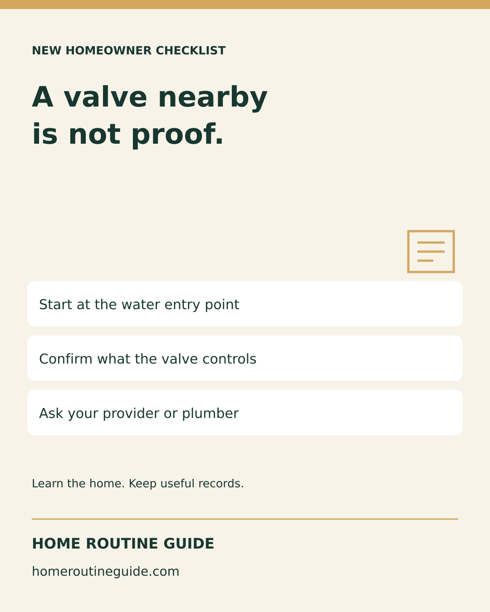
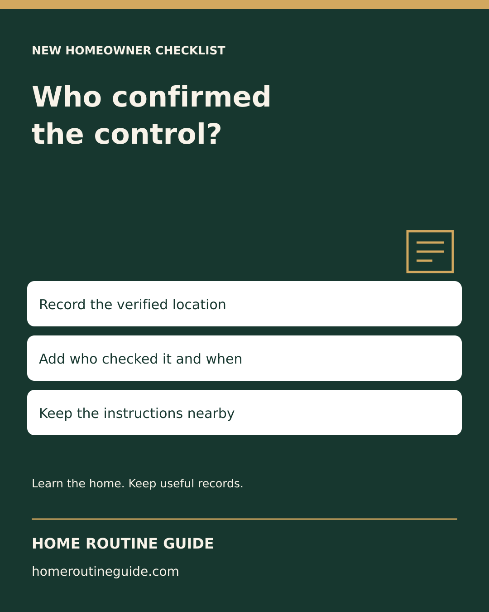
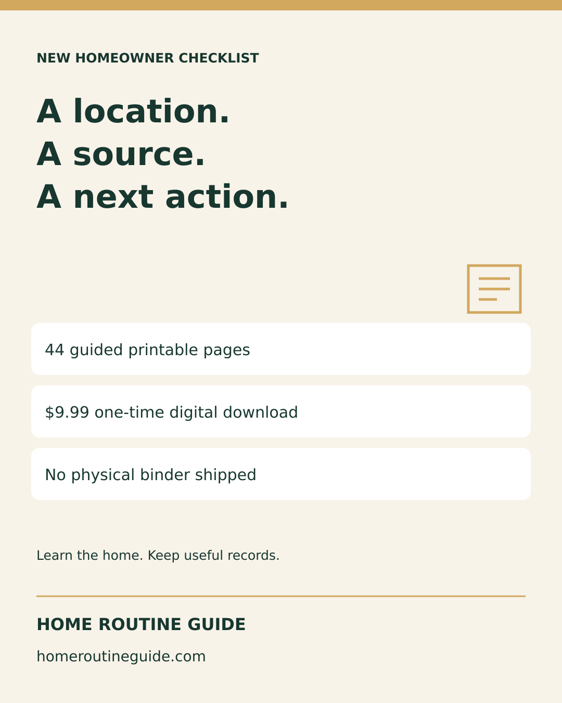

# Instagram and referral preparation — October 12, 2026

Three 1080 × 1350 feed graphics. Prepared only; confirm actual status in Metricool. Proposed dates: October 13, 15 and 17 at 10 a.m. America/New_York. Two free-resource posts and one $9.99 digital Binder promotion. Original vector artwork; no AI-generated people or product mockups.

## location-is-not-proof

A valve near your water heater is not automatically the main shutoff.

The first job is identification: where does the water supply enter, what does this control serve, and who is permitted to operate it? Ask your water provider, plumber or building manager when uncertain. Do not force a stuck or unfamiliar valve.

Our free guide explains common locations and the difference between house, fixture and utility valves. It is not a universal shutdown procedure.

Open homeroutineguide.com → Free Checklists → Popular homeowner questions → Where Is the Main Water Shutoff?

#NewHomeowner #HomeMaintenance #HomePreparation

Target: https://homeroutineguide.com/where-is-main-water-shutoff.html

Alt: Home Routine Guide: A valve nearby is not proof. Start at the water entry point; Confirm what the valve controls; Ask your provider or plumber.

## record-who-confirmed

“In the basement” is a clue. A verified household note is more useful.

After the correct water shutoff is confirmed, record five things: the route, what it controls, who confirmed it and when, the instruction reference, and who to call. Keep photos and completed notes private.

Use our free handoff checklist: homeroutineguide.com → Free Checklists → Popular homeowner questions → Where Is the Main Water Shutoff? → What to record. No signup or purchase required.

Shared buildings and fire-sprinkler systems need qualified guidance. Do not guess which control serves your home.

#NewHomeowner #HomeRecords #HomeOrganization

Target: https://homeroutineguide.com/where-is-main-water-shutoff.html#handoff

Alt: Home Routine Guide: Who confirmed the control? Record the verified location; Add who checked it and when; Keep the instructions nearby.

## guided-location-record

Want prompts for the home information you keep forgetting to record?

The New Homeowner Starter Binder includes 44 guided printable pages for shutoffs, equipment, warranties, repairs, contractors and planning. Start with one verified record rather than trying to fill every page at once.

One-time $9.99 digital download. No physical binder is shipped. It is an organizer, not a home inspection or professional diagnosis.

See the worksheet previews at homeroutineguide.com → Starter Binder → Preview the worksheets. Checkout opens on Kit. Our free guides remain available without a purchase.

#NewHomeowner #HomeOrganization #HomeMaintenance

Target: https://homeroutineguide.com/packages.html#preview

Alt: Home Routine Guide: A location. A source. A next action. 44 guided printable pages; $9.99 one-time digital download; No physical binder shipped.

## Public resource-list copy

New to the home? Home Routine Guide has a free checklist for recording a verified water shutoff: the location, what it controls, who confirmed it, the instructions and appropriate contacts. Confirm the control with your provider or qualified professional; keep completed household records private.

Destination: https://homeroutineguide.com/where-is-main-water-shutoff.html#handoff

No outreach, directory submission or partnership. Share the public URL; this does not authorize distribution of the paid household-use Binder.

Sources reviewed October 12, 2026: [WSSC Water](https://www.wsscwater.com/customer-service/report-problem/find-and-operate-your-main-water-valve) and [EVMWD](https://evmwd.com/meter-information/). These sources describe local systems; readers must confirm their own utility rules.
